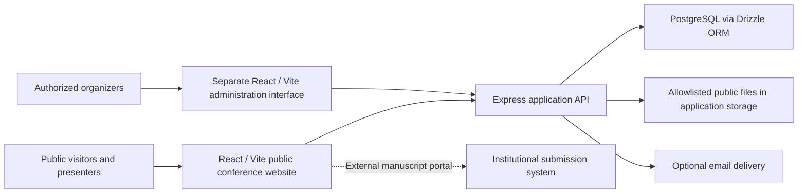

# iCATBio — International Conference on Advances & Trends in Biology

**Academic conference information and management platform · documentation-only portfolio**

[Live institutional website](https://icatbio.unesa.ac.id/) · [Developer academic profile](https://ichsan.ibios.org/) · [Related IBCE portfolio](https://github.com/mochammad-ichsan/ibce-v1.0)

> This repository describes inspected parts of the ICATBio 2026 software and its academic context. It does not contain the production application, a runnable distribution, institutional assets, participant information, or a license to reuse them. The live website is operated separately from this portfolio.

## Context and purpose

The first ICATBio conference, hosted in the context of the Department of Biology, Faculty of Mathematics and Natural Sciences, Universitas Negeri Surabaya (UNESA), brought together biology researchers, presenters, attendees, organizers, and international collaborators in 2026. The conference website presents event information, scientific themes, speakers, schedules, participation guidance, and a publicly reviewed abstract book. The application also contains separate registration and administration paths. ICATBio 2026 has concluded; the website now points visitors toward the annual 2027 edition without claiming a confirmed date or opening registration.

The software addresses practical coordination and communication needs in an academic conference: keeping public information consistent, making schedules discoverable, and collecting registration details for organizer follow-up. These are implemented capabilities, **not** evidence of improved efficiency, attendance, scholarly impact, or completed scientific review.

**Visual overview:** [open the official conference website](https://icatbio.unesa.ac.id/). No screenshot is redistributed in this portfolio because redistribution rights for the institutional visual assets in a screenshot have not been established. A direct link is not a claim that the current website exactly matches the inspected workspace.

## Verified feature map

| Area | Inspected behavior | Boundary |
| --- | --- | --- |
| Public information | Bilingual conference pages for themes, speakers, committee, dates, fees, and conference guidance | Some content comes from configured records and some from site data; prior-edition information may remain as an archive |
| Program | Main timetable and eight parallel-room schedules with search in the public interface | Program is an archive of the 2026 event, not a 2027 schedule |
| Public materials | Flipbook and PDF of a reviewed 104-page abstract book; downloadable virtual background | The public asset route only serves specifically allowlisted materials |
| Registration | Web form submits participant details to an application API; the server records data and can send email notifications when configured | This is not evidence of an active 2027 registration, payment processing, or completed attendance |
| Administration | Separate authenticated interface for managing conference content and viewing submitted records | Administrative paths and data are excluded from this repository |
| Submission and peer review | Public guidance links to an external institutional manuscript portal and explains a review process | The actual manuscript submission and peer-review decisions are **not** implemented by this application's API |

There is no verified in-application payment gateway, certificate generator, or end-to-end editorial/reviewer system. Public descriptions of those processes should not be mistaken for implemented internal workflows.

## System overview

This diagram is conceptual. It omits private implementation, infrastructure topology, credentials, deployment details, and internal endpoints. See [system architecture](docs/portfolio/SYSTEM_ARCHITECTURE.md) and [academic workflows](docs/portfolio/ACADEMIC_WORKFLOWS.md).

## Technology and development

Inspected workspace manifests and code show a pnpm TypeScript workspace, React/Vite public and administration interfaces, an Express API, PostgreSQL accessed through Drizzle ORM, Zod validation, OpenAPI/Orval-generated client code, and a file-backed public materials route. Authentication exists for organizer-facing administration; this portfolio does not reproduce its implementation or assert that it has undergone a security audit.

Mochammad Ichsan is identified in the portfolio request as a developer whose work should be attributed. Specific ownership, original authorship, institutional approval, and contributions from other organizers or developers require review. This documentation was prepared with AI assistance; neither all code nor all design ideas are claimed as exclusively human-authored. See [contributions](docs/portfolio/CONTRIBUTIONS.md) and [AI-assisted development disclosure](docs/portfolio/AI_ASSISTED_DEVELOPMENT.md).

## Portfolio contents and scope

| File | Purpose |
| --- | --- |
| [Project overview](docs/portfolio/PROJECT_OVERVIEW.md) | Institutional context, audience, and verified scope |
| [Architecture](docs/portfolio/SYSTEM_ARCHITECTURE.md) | Conceptual system boundaries |
| [Academic workflows](docs/portfolio/ACADEMIC_WORKFLOWS.md) | Verified participant and organizer paths |
| [Contributions](docs/portfolio/CONTRIBUTIONS.md) | Attribution and evidence-status matrix |
| [AI disclosure](docs/portfolio/AI_ASSISTED_DEVELOPMENT.md) | Scope of AI assistance and unknowns |
| [Technical validation](docs/portfolio/TECHNICAL_VALIDATION.md) | Checks performed and not performed |
| [Limitations](docs/portfolio/LIMITATIONS.md) | Reproducibility, rights, and capability limits |
| [Source attribution](SOURCE_ATTRIBUTION.md) | Why application source and third-party materials are excluded |
| [Rights notice](LICENSE.md) | No redistribution license is granted by this portfolio |

There is **no selected source code** or application screenshot: access to an institutional workspace and public visibility of its website do not establish redistribution rights. Consequently this is **not** a runnable standalone application or an open-source software release. `SOURCE_MANIFEST.sha256` is not included because no source files are published.

## Citation, validation, and rights

This document is a portfolio overview, not an academic article or a peer-reviewed validation. The [technical validation record](docs/portfolio/TECHNICAL_VALIDATION.md) distinguishes inspected code and limited tests from unverified production behavior. A `CITATION.cff` is intentionally omitted pending confirmation of the complete authorship and citation metadata; no DOI, ORCID, software release date, or additional author is invented.

The [rights notice](LICENSE.md) does not license institutional branding, code, third-party material, manuscripts, or personal data. For the live conference, visit the [institutional website](https://icatbio.unesa.ac.id/). For the developer's academic profile, visit [ichsan.ibios.org](https://ichsan.ibios.org/). The [IBCE repository](https://github.com/mochammad-ichsan/ibce-v1.0) informed the documentation structure only; its license and scientific claims do not apply to ICATBio.
